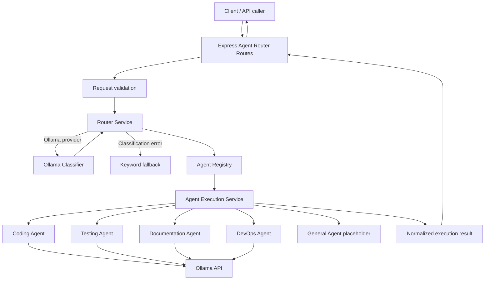
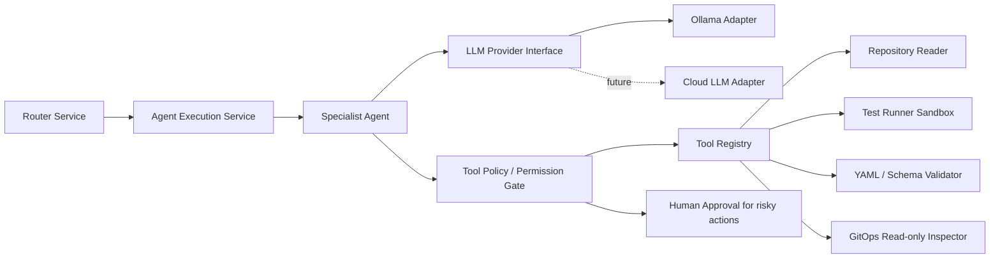

**Project:** `tdd-react-typescript-app`  
**Backend:** Node.js, Express, TypeScript, Vitest  
**LLM provider currently configured:** Ollama  
**Document purpose:** Record the router implementation from initial setup through current status, and describe how real/specialized agents can be integrated in future.

> **Implementation status note:** This document reflects the project details currently available in the conversation. The configuration, routing foundation, Ollama classification, execution framework, and four agent implementations have been described as present. The General Agent remains a placeholder. The test suite most recently reported 8 test files and 44 tests passing, followed by a successful TypeScript build. Review the actual repository before treating every path or example below as an exact copy of current source code. Code marked “illustrative” is a design example, not a claim that it already exists in the repository.

---

## 1. Executive Summary

The AI Agent Router is a backend layer that accepts a user request, determines which specialist should handle it, selects the corresponding agent from a registry, and invokes that agent through a common execution interface.

The current implementation establishes the **routing and execution foundation**. It is configured to use Ollama as the local model provider. Ollama is used for request classification and for the implemented agents' LLM calls. The router also has a keyword-based fallback when model-based classification fails.

The router currently recognizes five agent IDs:

- `coding`
- `testing`
- `devops`
- `documentation`
- `general`

The first four are described as implemented; `general` remains a placeholder. “Implemented” here means an agent class and execution path exist. It does **not** mean that the system has autonomous access to the repository, terminal, Kubernetes cluster, cloud accounts, or external services. Those capabilities require explicit tools, permissions, validation, and safety controls.

### Current status at a glance

| Area | Current status |
|---|---|
| Environment-based configuration | Implemented |
| Ollama provider/model configuration | Implemented |
| Agent registry and agent IDs | Implemented |
| LLM-based request classification | Implemented |
| Keyword fallback classification | Implemented |
| Shared agent execution service | Implemented |
| Coding Agent | Implemented |
| Testing Agent | Implemented |
| Documentation Agent | Implemented |
| DevOps Agent with YAML syntax validation | Implemented |
| General Agent | Placeholder |
| Automated tests | 44 passing in latest reported run |
| TypeScript build | Successful in latest reported run |
| Real repository/terminal/cloud tools | Not established by the current evidence; future integration |
| Production readiness | Not yet demonstrated |

---

## 2. Objectives and Scope

### Goals

1. Centralize request classification and agent selection.
2. Keep routing separate from specialist execution.
3. Allow agents to share a consistent input/output contract.
4. Configure the provider, model, timeout, default agent, and feature toggle through environment variables.
5. Fall back to deterministic keyword routing when model classification fails.
6. Test routing and execution behavior independently.
7. Make future agents and tools pluggable without rewriting the entire router.

### Out of scope for the current foundation

The current foundation should not be confused with a fully autonomous agent platform. The following capabilities require further work unless confirmed in the repository:

- Running shell commands on the user's behalf.
- Reading and modifying arbitrary repository files.
- Creating commits or opening pull requests.
- Running tests in an isolated sandbox.
- Applying Kubernetes manifests or changing cloud infrastructure.
- Calling external services with production credentials.
- Multi-step planning, tool selection, and execution loops.
- Human approval workflows for sensitive operations.
- Persistent memory, retrieval-augmented generation (RAG), or vector search.

---

## 3. High-Level Architecture



### Responsibility boundaries

| Component | Responsibility |
|---|---|
| Routes | HTTP endpoints, input validation, HTTP response formatting |
| Config | Read and expose environment-driven settings |
| Classifier | Predict the best agent ID from the user request |
| Router service | Apply explicit-agent preference, classification, fallback, and registry lookup |
| Registry | Define supported agents and their status/metadata |
| Agent interface | Standard contract for specialist agents |
| Execution service | Find and invoke the selected agent; normalize execution failures |
| Specialist agents | Build role-specific prompts and call the configured LLM |
| DevOps output validator | Check YAML syntax in supported output patterns |
| Tests | Verify expected routing, validation, error, and agent behavior |

**Design principle:** The router chooses *who should handle the request*. The agent handles *how to respond or act*. External tools should be called by a controlled tool layer, not directly by the classifier.

---

## 4. Configuration

The current `.env` settings have been reported as:

```dotenv
AGENT_ROUTER_ENABLED=true
AGENT_ROUTER_PROVIDER=ollama
AGENT_ROUTER_DEFAULT_AGENT=general
OLLAMA_BASE_URL=http://localhost:11434
OLLAMA_MODEL=llama3.2:3b
OLLAMA_TIMEOUT_MS=30000
```

### Setting explanations

| Variable | Purpose |
|---|---|
| `AGENT_ROUTER_ENABLED` | Enables/disables the router feature |
| `AGENT_ROUTER_PROVIDER` | Selects the configured LLM provider; currently `ollama` |
| `AGENT_ROUTER_DEFAULT_AGENT` | Default/fallback agent identifier, subject to router behavior |
| `OLLAMA_BASE_URL` | Base URL for the local Ollama API |
| `OLLAMA_MODEL` | Model name sent to Ollama |
| `OLLAMA_TIMEOUT_MS` | Upper bound for an Ollama request |

The backend loads environment configuration through `dotenv/config` in the server entry point, according to the current project notes.

### Configuration practices

- Keep `.env` out of version control; commit an `.env.example` containing non-secret defaults.
- Validate environment values at startup. Reject unsupported providers and invalid timeout values.
- Do not silently fall back to a different model or provider without logging a safe, structured reason.
- Keep the provider URL configurable so a local, containerized, or remote Ollama service can be selected.
- Use a provider adapter if more providers are added. Avoid scattering provider-specific HTTP calls throughout routing code.
- The default agent setting and classification fallback behavior should be tested separately; a default ID does not automatically make a placeholder agent executable.

### Example `.env.example`

```dotenv
AGENT_ROUTER_ENABLED=true
AGENT_ROUTER_PROVIDER=ollama
AGENT_ROUTER_DEFAULT_AGENT=general
OLLAMA_BASE_URL=http://localhost:11434
OLLAMA_MODEL=llama3.2:3b
OLLAMA_TIMEOUT_MS=30000
```

This is a template only. Keep credentials, if introduced by a future provider, in an appropriate secret manager rather than committing them.

---

## 5. Agent Catalog

### 5.1 Coding Agent

**Intended role:** Help with programming tasks such as explaining code, suggesting implementations, debugging, and generating code snippets.

**Current execution model:** Calls Ollama with a coding-specific system prompt and returns generated text. The current evidence does not establish that it can edit files or execute code.

**Future tools that could be connected:**
- Read-only repository search.
- File reader for explicitly permitted project files.
- Patch/diff generator.
- Sandboxed test runner.
- Human-approved file write or pull-request workflow.

### 5.2 Testing Agent

**Intended role:** Help design tests, diagnose failures, and explain test strategies.

**Current execution model:** Calls Ollama with a testing-specific prompt and returns generated text. Do not assume it actually runs tests unless a test-runner tool is connected.

**Future tools:**
- Test-file discovery.
- Sandboxed test command runner.
- Coverage report reader.
- Failure log summarizer.

### 5.3 Documentation Agent

**Intended role:** Create or improve technical documentation based on supplied context.

**Current execution model:** Calls Ollama with a documentation-specific prompt. Project context includes an npm workspace with a backend workspace and Vitest commands, according to current notes. Generated instructions should still be checked against the real repository.

**Future tools:**
- Repository tree reader.
- Markdown file reader.
- Documentation diff generator.
- Approved file-write tool.

### 5.4 DevOps Agent

**Intended role:** Help with infrastructure, Docker, CI/CD, Kubernetes, GitOps, and deployment configuration.

**Current execution model:** Calls Ollama and validates YAML syntax in fenced YAML blocks. If syntax validation fails, it can ask the model to correct the response once, then fail if the result remains invalid.

**Important limitation:** YAML syntax validation does not prove that a Kubernetes manifest is valid against a cluster API, secure, deployable, or semantically correct. It does not prove that a command is safe to run.

**Future tools:**
- YAML parser and schema validation.
- `kubectl` read-only inspection in a controlled environment.
- Helm/Kustomize render checks.
- CI pipeline status reader.
- GitOps diff/health reader.
- Approval-gated deployment action.

### 5.5 General Agent

**Current status:** Placeholder. It is registered as a supported agent ID, but the current execution map described in the project notes does not include a General Agent implementation.

**Future role:** Handle general questions and requests that do not clearly belong to another specialist.

**Recommended first implementation:** A simple LLM-backed agent with a general-purpose system prompt, using the same common agent interface and provider client as other agents.

---

## 6. Request Lifecycle: Initial Request to Final Response

Consider this example request:

> “Write a unit test for a TypeScript function.”

### Step 1 — API request

A client submits a request to the execution endpoint:

```http
POST /api/agent-router/execute
Content-Type: application/json
```

Example body:

```json
{
  "message": "Write a unit test for a TypeScript function."
}
```

This is an illustrative request shape. Confirm the route schema in `backend/src/routes/agent-router.routes.ts` before integrating another client.

### Step 2 — Request validation

The route should reject missing or empty messages, unsupported agent IDs, and messages over its configured length limit. The current project notes report a 4,000-character limit for `/execute` and a 10,000-character limit for `/route`.

### Step 3 — Select an agent

If the caller explicitly supplies a supported `preferredAgent`, the router uses that preference. Otherwise, with the Ollama provider configured, it asks the classifier to choose an agent. If classification fails, keyword fallback logic is used.

For this example, the likely result is `testing`.

### Step 4 — Resolve the registry entry

The router looks up `testing` in the registry and checks whether it is implemented. A placeholder should not be presented as executable.

### Step 5 — Execute the selected agent

The execution service looks up the testing implementation and passes the request through the common agent contract. The testing agent sends a role-specific prompt to Ollama.

### Step 6 — Handle the result

The agent returns generated content or throws an error. The execution service normalizes failures rather than leaking raw provider internals. The route returns the resulting status and output to the caller.

### Step 7 — Observe and test

Useful telemetry includes request ID, selected agent, provider/model identifier, duration, success/failure category, and retry count. Avoid logging secrets, full prompts, tokens, or sensitive user data by default.

---

## 7. API Surface

The project notes report these routes:

| Method | Endpoint | Purpose |
|---|---|---|
| `GET` | `/api/agent-router/status` | Read router configuration/status |
| `POST` | `/api/agent-router/route` | Classify/select an agent without executing it |
| `POST` | `/api/agent-router/execute` | Route and execute a request |

### Example: route only

```bash
curl -X POST http://localhost:4000/api/agent-router/route \
  -H 'Content-Type: application/json' \
  -d '{"message":"Write unit tests for this function"}'
```

### Example: execute

```bash
curl -X POST http://localhost:4000/api/agent-router/execute \
  -H 'Content-Type: application/json' \
  -d '{"message":"Write unit tests for this function"}'
```

These examples assume the backend listens on port `4000`, as used in the wider project context. If the backend's actual port differs, replace it. Exact response properties should be taken from the current route implementation rather than guessed.

### Suggested API response contract for future consistency

```json
{
  "routing": {
    "agentId": "testing",
    "status": "ready",
    "reason": "The request asks for unit tests."
  },
  "execution": {
    "status": "success",
    "output": "Example generated output..."
  }
}
```

This is a **proposed response shape**, not a guarantee of the current API's exact JSON structure.

---

## 8. Where the Current Foundation Ends

A model-backed agent is not automatically a tool-using agent.

### Current model-backed behavior

```text
User request
   → Router
   → Agent
   → Prompt + LLM request
   → Text response
```

### Future tool-using behavior

```text
User request
   → Router
   → Specialist agent
   → Plan / decide next action
   → Tool policy checks
   → Approved tool call
   → Tool result
   → Agent interprets result
   → Final response
```

The second flow requires new components: tool definitions, argument validation, permission checks, execution isolation, timeouts, audit logs, and potentially human approval. It should not be treated as present simply because an agent class exists.

---

## 9. Future Integration: What Is a “Real Agent”?

The phrase “real agent” can mean several different capability levels:

| Level | Capability | Example |
|---|---|---|
| 1. LLM-backed responder | Sends a role-specific prompt and returns text | Current Coding Agent behavior |
| 2. Context-aware agent | Reads approved project context before answering | Coding Agent reads selected files |
| 3. Tool-using agent | Can invoke approved tools | Testing Agent runs a test command in a sandbox |
| 4. Workflow agent | Executes multiple verified steps and handles intermediate results | DevOps Agent renders manifests, checks diffs, requests approval |
| 5. Production-grade agent | Adds policy enforcement, isolation, auditability, retries, monitoring, and approval flows | Controlled deployment workflow |

The current project is primarily at Level 1, with an additional YAML syntax-validation step for DevOps output. It should not be described as having Level 3 or Level 4 capabilities until tools and workflows are implemented and tested.

---

## 10. Recommended Future Architecture

A cleaner long-term architecture separates model access, agent logic, and tools:



### Suggested module boundaries

These are proposed future modules, not claims about existing files:

```text
backend/src/agent-router/
├── types.ts
├── config.ts
├── registry.ts
├── router.service.ts
├── ollama.classifier.ts
├── execution/
│   ├── agent.interface.ts
│   └── agent-execution.service.ts
├── providers/
│   ├── llm-provider.interface.ts
│   └── ollama.provider.ts
├── agents/
│   ├── coding.agent.ts
│   ├── testing.agent.ts
│   ├── documentation.agent.ts
│   ├── devops.agent.ts
│   └── general.agent.ts
├── tools/
│   ├── tool.interface.ts
│   ├── tool-registry.ts
│   ├── repository-reader.tool.ts
│   ├── test-runner.tool.ts
│   └── yaml-validator.tool.ts
└── policies/
    ├── tool-policy.service.ts
    └── approval.service.ts
```

Do not create all these modules at once. Add them incrementally as the product requirements demand them.

---

## 11. Example: Adding a General Agent

The following is an illustrative pattern. Adapt imports, response types, and configuration access to the exact existing interfaces in the repository.

### Step 1 — Implement the common agent contract

The agent should follow the same interface as the other agents, accept a typed input, and return a typed result.

Illustrative pseudocode:

```ts
export class GeneralAgent implements Agent {
  async execute(input: AgentInput): Promise<AgentResult> {
    // Build a general-purpose system prompt.
    // Call the configured LLM provider.
    // Validate that the returned content is non-empty.
    // Return a normalized result.
  }
}
```

### Step 2 — Register it in the execution service

Add `general: new GeneralAgent()` to the executor map only after the implementation is ready. Keep registry metadata and executable implementation status aligned.

### Step 3 — Test the behavior

Tests should cover:
- Successful response.
- Empty LLM content.
- Provider HTTP error.
- Network failure.
- Timeout/abort.
- Correct agent ID and normalized result.
- Placeholder behavior before implementation and executable behavior after registration.

### Step 4 — Update documentation and status

Update the agent catalog, status endpoint expectations, and router tests. Do not mark the agent `implemented` until the execution path and tests are in place.

---

## 12. Example: Connecting a Testing Agent to a Real Test Runner

This is a future design example. It is not currently confirmed as implemented.

### Desired workflow

1. The user asks: “Run backend tests and explain failures.”
2. The Testing Agent identifies the request as a test-runner task.
3. The agent requests a `run_tests` tool call with a predefined command.
4. The tool policy checks the permitted workspace and command.
5. A sandbox runs the tests with resource/time limits.
6. The tool returns exit code and bounded stdout/stderr.
7. The agent summarizes actual results, distinguishing observed failures from hypotheses.

### Safety rules

- Do not pass arbitrary model-generated shell commands directly to a shell.
- Prefer fixed command templates, allowlisted arguments, and a known working directory.
- Run commands in an isolated environment with time, memory, process, and filesystem limits.
- Do not expose production secrets to the test process.
- Bound output size and redact secrets before logging.
- Require approval for destructive commands or operations that modify shared environments.

### Proposed tool result

```json
{
  "tool": "run_tests",
  "status": "completed",
  "exitCode": 1,
  "stdout": "42 tests passed",
  "stderr": "2 tests failed",
  "truncated": false
}
```

The result should be generated from the actual process execution. The agent must not invent test counts or claim that tests ran when the tool did not run.

---

## 13. Example: Giving the DevOps Agent Validated Infrastructure Tools

The current DevOps Agent's YAML syntax check is a useful first guard, but it is not a deployment safety system.

### Proposed validation ladder

1. Parse YAML syntax.
2. Validate against Kubernetes/OpenAPI schemas.
3. Render Helm/Kustomize output.
4. Run policy/security checks.
5. Show a human-readable diff.
6. Require approval before applying changes.
7. Apply only through a restricted identity.
8. Verify rollout health and report observed results.

### Important distinction

`kubectl apply --dry-run=client` or a YAML parser can catch some problems, but neither alone proves that a deployment will succeed or that a manifest is safe. Server-side validation, policy checks, and a controlled target environment may also be needed.

Never give an LLM unrestricted cluster credentials or allow it to apply infrastructure changes without policy and approval controls.

---

## 14. Reliability and Error Handling

A future reliability pass should define stable error categories. Suggested categories include:

| Category | Meaning | Suggested handling |
|---|---|---|
| `ROUTER_DISABLED` | Feature is disabled | Return a clear disabled response |
| `INVALID_REQUEST` | Missing/invalid input | HTTP 400 |
| `UNSUPPORTED_AGENT` | Agent ID is not supported | HTTP 400 |
| `AGENT_NOT_IMPLEMENTED` | Registry entry is a placeholder | Clear non-executable response |
| `CLASSIFICATION_FAILED` | Classifier failed | Use fallback if safe; record failure |
| `PROVIDER_TIMEOUT` | LLM request exceeded timeout | Return controlled timeout response |
| `PROVIDER_UNAVAILABLE` | Ollama/provider could not be reached | Return controlled availability error |
| `PROVIDER_BAD_RESPONSE` | Invalid JSON or empty content | Fail safely; do not treat as success |
| `AGENT_EXECUTION_FAILED` | Agent threw an unexpected error | Return a normalized failure and log correlation ID |
| `TOOL_PERMISSION_DENIED` | Tool action is not permitted | Stop and explain the restriction |
| `TOOL_EXECUTION_FAILED` | Tool failed | Report observed error without fabricating success |

These are recommended categories; they may not match the exact current error constants.

### Logging recommendations

Log:
- Request/correlation ID.
- Selected agent.
- Provider/model name (not credentials).
- Duration and result category.
- Tool name and permission decision.
- Retry count.

Avoid logging:
- API keys or access tokens.
- Full sensitive prompts by default.
- Private repository content unless explicitly required and controlled.
- Secrets included in process output.

### Timeout recommendations

- Keep a provider timeout.
- Add an overall request deadline so classification plus execution cannot exceed a reasonable total.
- Use abort signals correctly.
- Test timeout paths with fake timers to avoid slow, flaky tests.
- Attach rejection handlers before advancing timers in timeout tests.
- Ensure retries are bounded and do not multiply total latency indefinitely.

---

## 15. Testing Strategy

The latest reported baseline is:

```text
Test Files  8 passed (8)
Tests       44 passed (44)
TypeScript  build successful
```

These results are based on the user's latest terminal output. They are not a new test run performed while writing this document.

### Existing reported test areas

- Application API tests.
- Agent Router foundation tests.
- Agent execution service tests.
- Coding Agent tests.
- Testing Agent tests.
- Documentation Agent tests.
- DevOps Agent tests.
- DevOps YAML output validator tests.

### Recommended additional tests

1. General Agent implementation and error cases.
2. Classifier malformed response and unsupported ID.
3. Fallback behavior when Ollama is unavailable.
4. End-to-end `/execute` success and failure responses.
5. Router disabled behavior.
6. Provider timeout and cancellation for every shared provider path.
7. Tool authorization denial.
8. Tool output truncation and secret redaction.
9. Schema validation failure for Kubernetes YAML.
10. Regression tests for fabricated commands and unverified claims.

### Suggested verification commands

Run from the repository root:

```bash
npm run test --workspace backend
npm run build --workspace backend
```

For an API smoke test, first confirm the backend port and startup command, then call `/api/agent-router/status`, `/route`, and `/execute`. Use test-safe requests and do not point experimental tool execution at production infrastructure.

---

## 16. Implementation Roadmap: Initial to Production-Oriented

### Phase 1 — Foundation (current)

- [x] Define agent IDs and status types.
- [x] Add environment-based router configuration.
- [x] Add agent registry.
- [x] Implement Ollama-based classifier.
- [x] Add keyword fallback.
- [x] Add shared execution service/interface.
- [x] Implement Coding, Testing, Documentation, and DevOps agents.
- [x] Add YAML syntax validation for DevOps output.
- [x] Add route endpoints and input validation.
- [x] Establish automated tests and TypeScript build.
- [ ] Implement General Agent.

### Phase 2 — Provider abstraction

- [ ] Introduce a common LLM provider interface.
- [ ] Move Ollama-specific HTTP calls into one adapter/client.
- [ ] Normalize provider errors and timeout behavior.
- [ ] Add startup config validation and provider health checks.
- [ ] Add safe structured logs and request IDs.

### Phase 3 — Grounded context

- [ ] Add an allowlisted repository reader.
- [ ] Supply relevant project files to agents as explicit context.
- [ ] Require agents to distinguish repository facts from assumptions.
- [ ] Add tests for unsupported commands and invented file paths.
- [ ] Keep context bounded and redact secrets.

### Phase 4 — Safe tools

- [ ] Add a typed tool interface and registry.
- [ ] Add policy/permission checks for every tool call.
- [ ] Implement a read-only repository tool first.
- [ ] Implement test execution in a sandbox.
- [ ] Add bounded output and execution time limits.
- [ ] Add approval gates for file writes, commits, deployments, or destructive actions.

### Phase 5 — Specialist workflows

- [ ] Testing workflow: inspect → run tests → parse results → summarize.
- [ ] Coding workflow: inspect → propose diff → run checks → request approval to write.
- [ ] Documentation workflow: inspect sources → draft docs → verify file paths and commands.
- [ ] DevOps workflow: render → validate → inspect diff → approve → deploy → verify health.
- [ ] Add cancellation and overall deadlines.

### Phase 6 — Production hardening

- [ ] Authentication and authorization for API access.
- [ ] Rate limiting and request-size limits.
- [ ] Secret management.
- [ ] Audit logs for tool actions.
- [ ] Monitoring for latency, error rate, token/model usage, and tool failures.
- [ ] Security review and threat modeling.
- [ ] Load and failure testing.
- [ ] Document rollback and incident response procedures.

---

## 17. Definition of Done for a Real Tool-Using Agent

An agent should not be considered “real” merely because it has a prompt and an LLM call. For a tool-using agent, the definition of done should include:

- [ ] Clear scope and supported operations.
- [ ] Typed request/response contracts.
- [ ] Reliable provider abstraction and timeout handling.
- [ ] Explicit tool schema and argument validation.
- [ ] Allowlist and permission checks.
- [ ] Sandboxed execution where applicable.
- [ ] Human approval for high-impact actions.
- [ ] Structured, redacted audit logs.
- [ ] Unit and integration tests.
- [ ] Clear failure responses and cancellation.
- [ ] Documentation that distinguishes implemented capabilities from planned ones.
- [ ] Demonstration that tool results are real and are not fabricated by the model.

---

## 18. Final Assessment

The project has moved beyond a configuration-only stub: it has a functioning routing foundation, an Ollama classifier, a registry, a shared execution service, four LLM-backed specialist agents, DevOps YAML syntax validation, API routes, and a passing reported test suite.

However, **LLM-backed response generation is not the same as autonomous tool execution**. The current evidence does not establish that agents can actually read and edit the repository, run tests, execute arbitrary commands, or deploy infrastructure. Those capabilities should be added as explicit, permission-controlled tools and verified through integration tests.

### Recommended next sequence

1. Implement `GeneralAgent`.
2. Consolidate Ollama access behind a reusable provider client.
3. Standardize provider and execution error handling.
4. Add API-level integration tests for `/execute`.
5. Add a read-only repository context tool.
6. Add sandboxed test execution.
7. Add approval-gated file changes and DevOps actions only when needed.

This sequence builds on the existing foundation while keeping model-generated suggestions separate from verified actions.
"""

output_path = "/mnt/data/ai-agent-router-implementation-guide.md"
pypandoc.convert_text(content, "md", format="md", outputfile=output_path, extra_args=["--standalone"])
print(f"Created: {output_path}")
